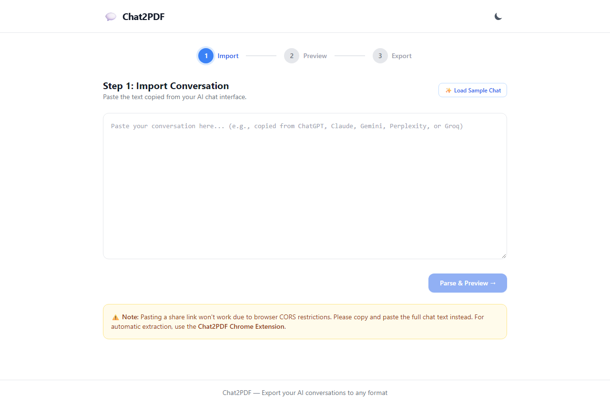
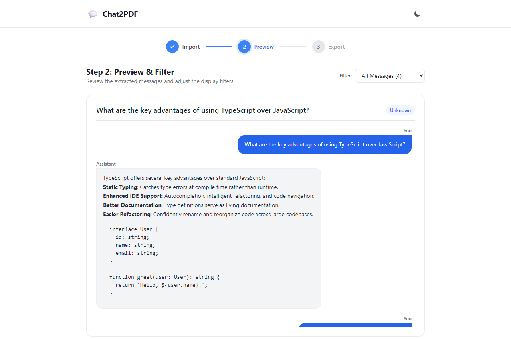
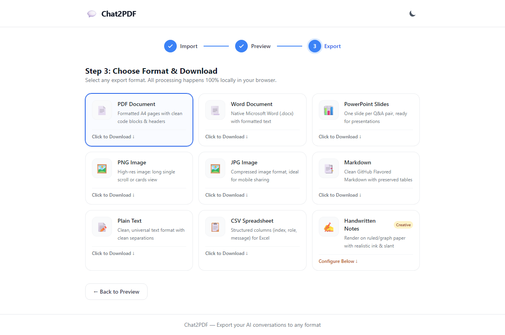
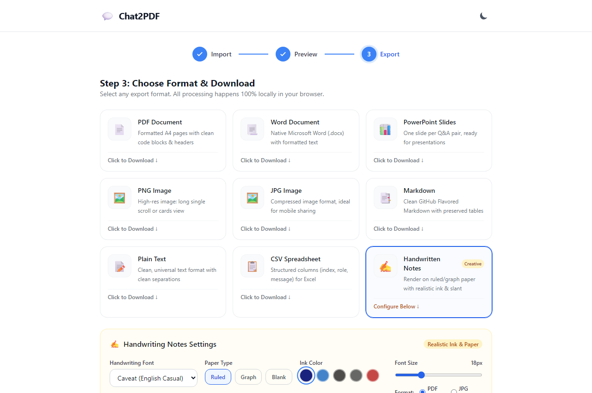

# Chat2PDF 💬

> Turn AI conversations into beautifully formatted, downloadable documents — 100% locally in your browser. No backend, no servers, no API keys, and offline-capable.

Chat2PDF ships as **two products from one shared codebase**:
1. **Web App (PWA)**: Paste chat text from any AI, preview, filter, and export. Works offline once loaded.
2. **Chrome Extension (Manifest V3)**: Directly extracts chats from active tabs (chatgpt.com, gemini.google.com, claude.ai, perplexity.ai, groq.com) and opens the exporter UI with one click.

---

## 📸 Visual Walkthrough

### Step 1: Import Conversation
Paste text directly or click **Load Sample Chat** to test immediately.

### Step 2: Clean Preview & Filter
Preview markdown, code blocks, tables, and roles with options for *All*, *Answers Only*, *Questions Only*, or *Summary*.

### Step 3: Choose Format & Download
Select from 8 client-side export engines with live feedback.

### Handwritten Notes Mode
Realistic handwritten paper output with customizable fonts (*Caveat*, *Indie Flower*, *Kalam*, *Hind*), ruled/graph/blank paper, and ink color control.

---

## 🌟 Supported Export Formats (All 100% Client-Side)

1. **📄 PDF Document**: Formatted A4 pages, styled code blocks with syntax background, role banners, and page counters using jsPDF.
2. **📃 Word Document (.docx)**: Native Microsoft Word files formatted with headings, message paragraphs, and clean styling via docx.
3. **📊 PowerPoint (.pptx)**: Presentation slides with one slide per Q&A pair and title card using PptxGenJS.
4. **🖼️ PNG / JPG Images**:
   - **Long Mode**: Entire conversation captured as a single high-resolution image using html-to-image.
   - **Short Mode**: Compact question + key answer cards view.
5. **📑 Markdown (.md)**: Clean GitHub-flavored markdown with preserved code blocks, lists, and tables.
6. **📝 Plain Text (.txt)**: Clean human-readable text file with clear role demarcations.
7. **📋 CSV Spreadsheet**: Structured table (index, role, message) ready for Excel, Sheets, or data pipelines via PapaParse.
8. **✍️ Handwriting Notes Mode**:
   - Realistic handwritten pages rendered directly onto canvas.
   - **Fonts**: *Caveat* (casual cursive), *Indie Flower* (playful), *Kalam* (Devanagari/Hindi handwriting), and *Hind* (clean Hindi).
   - **Paper Types**: Ruled lines, Grid/Graph paper, or Blank paper.
   - **Customizable Inks**: Deep blue, royal blue, classic black, charcoal, and red ink.
   - **Physics simulation**: Natural slight variations in character rotation, baseline slant, and ink opacity.
   - **Export Options**: Multi-page PDF or high-res JPG images.

---

## 🔌 Install the Chrome Extension

1. Clone or download this repository and run 
pm run build:extension (or 
pm run build).
2. Open your browser and navigate to chrome://extensions/ (or rave://extensions/ / edge://extensions/).
3. Enable **Developer mode** in the top-right corner.
4. Click **Load unpacked**.
5. Select the dist-extension folder generated inside this repository.
6. Visit any supported chat interface: chatgpt.com, gemini.google.com, claude.ai, perplexity.ai, or groq.com.
7. Click the **Chat2PDF** icon in your browser toolbar and click **Export this chat**.

---

## 🚀 Development & Web App Usage

`ash
# Install dependencies
npm install

# Run development server
npm run dev

# Build standalone PWA web application
npm run build:web

# Build Chrome Extension
npm run build:extension

# Build both
npm run build
`

---

## 📄 License

Distributed under the MIT License. See [LICENSE](LICENSE) for details.
